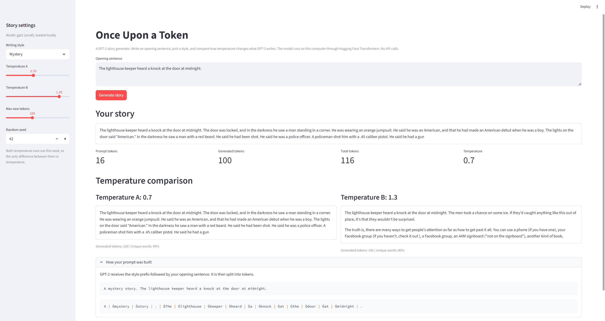

# Once Upon a Token: GPT-2 Interactive Story Generator

Once Upon a Token is a local story generation web app built with Streamlit and PyTorch. It generates a continuation of a user-provided opening sentence using a selected writing style and compares outputs at two different temperature values. The application runs the small GPT-2 model completely on your local computer using Hugging Face Transformers without any external API calls.



## Features

- **Controls**: Choose from six writing styles (Mystery, Fantasy, Horror, Sci-Fi, Romance, Fairy tale). Adjust two separate temperature sliders (Temperature A and Temperature B) from 0.1 to 1.5. Set the maximum number of new tokens between 30 and 200. Configure an integer random seed for repeatable generations.
- **Outputs**: Read the full generated story continuation. Check prompt token count, generated token count, and total token count. View a side-by-side temperature comparison with unique word ratios to see how randomness affects lexical diversity. Inspect the full prompt text and individual subword tokens in an expander.

## Project Structure

```text
story_generator/
├── app.py                  # Streamlit web application interface
├── backend/
│   ├── __init__.py         # Package marker for the backend modules
│   ├── generator.py        # Generates text continuations using GPT-2 and PyTorch
│   ├── model_loader.py     # Loads the GPT-2 model and tokenizer (cached in app.py with st.cache_resource)
│   ├── output.py           # Calculates token metrics, lexical diversity, and temperature comparisons
│   └── preprocessing.py    # Formats style prefixes and validates user input
├── tests/
│   └── test_generation.py  # Automated pytest suite with 14 unit tests
├── conftest.py             # Pytest configuration file for module resolution
├── requirements.txt        # Project dependencies
├── screenshot.png          # Screenshot of the web interface
└── README.md               # Project documentation and instructions
```

## Setup and Run

This project was developed and tested using Python 3.14.0.

1. Install the required dependencies:
```bash
pip install -r requirements.txt
```

2. Start the Streamlit application:
```bash
streamlit run app.py
```

The first run downloads the GPT-2 model weights from Hugging Face, so it takes a little longer to start. After that, the weights stay stored locally in the Hugging Face cache folder for fast loading.

## How It Works

1. **Preprocessing**: The user types an opening sentence and selects a style. The app trims whitespace and prepends a short style prefix such as "A mystery story."
2. **Model Loading**: The app downloads and loads the `gpt2` tokenizer and language model with PyTorch. It maps the end-of-sequence token as the pad token, moves the weights to GPU if available, and turns on evaluation mode.
3. **Generation**: The prompt text is tokenized into input tensor IDs. The model generates new tokens autoregressively using sampling, stopping when the requested token count is reached. Only the newly generated tokens are decoded back to text.
4. **Output Evaluation**: The app counts the tokens with the tokenizer and computes the percentage of unique words in the text. It then presents both temperature outputs side by side.

### Parameters Explained

- **Temperature**: Controls how random token choices are. Low temperatures (like 0.3) favor only high-probability words, producing repetitive or predictable text. High temperatures (like 1.3) flatten the distribution, producing surprising or chaotic text.
- **Top-k**: Keeps only the 50 most likely next tokens at every step. This prevents the model from choosing nonsensical low-probability tokens.
- **Random seed**: Fixes the random number generator before sampling. Running the same prompt and temperature with the same seed produces the exact same text every time.

## Tests

Run the unit tests from the `story_generator` folder:

```bash
pytest
```

The test suite checks tokenization integrity, autoregressive token-by-token generation, model parameter count and dimensions, and the effects of temperature sampling. All 14 tests pass.

## Limitations

- GPT-2 small is a raw language model and is not instruction-tuned. The style prefix has only a subtle guiding effect, and generated text can sometimes wander or become repetitive.
- The model has no safety filter or content moderation. Some generations can contain odd, confusing, or unwanted phrases depending on the prompt and random seed.
